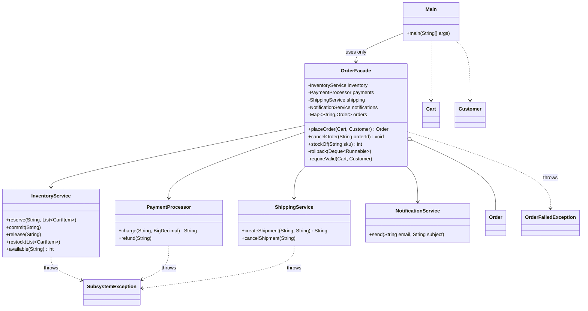

# Assignment #4: Facade Pattern. Online Order Processing

**Course:** ShP-2216 Software Design Patterns | **Student:** Tolegen Zhassulan, SE-2526

## 1. Introduction
Placing an online order is not one action. The system must reserve stock (`InventoryService`), charge the customer (`PaymentProcessor`), create a shipment (`ShippingService`), confirm stock and notify the customer (`NotificationService`). The order of these steps matters, and when a step fails the earlier ones must be undone (for example, a declined payment must release reserved stock; a shipping failure must refund the payment).

If every client had to orchestrate this itself, the logic would be duplicated and error-prone. The **Facade** pattern solves this: `OrderFacade` offers `placeOrder(cart, customer)` and `cancelOrder(orderId)`, coordinates the subsystem in the right order and performs the rollback. The client uses only the Facade.

## 2. UML Class Diagram
Render with https://mermaid.live (export PNG/SVG for Moodle) or use any Mermaid-compatible tool.


Arrows go only from the Facade to the subsystem classes, never back.

## 3. Clean Code Principles

**1. Meaningful names: a self-explanatory API**
```java
// Before: client must know the protocol
svc.doIt(c, u, 1, true);
// After
Order order = shop.placeOrder(cart, customer);
shop.cancelOrder(order.orderId());
```
*Why:* the method names say what the business does, not how.

**2. Single Responsibility: the Facade coordinates, it does not reimplement**
```java
// Before (logic inside the facade)
if (balances.get(id) < total) { ... balances.put(id, balances.get(id) - total); }
// After (delegation)
String transactionId = payments.charge(customer.id(), cart.total());
```
*Why:* money logic lives in `PaymentProcessor`; the Facade only decides the order of calls.

**3. No leaking of subsystem details**
```java
// Before: client must catch PaymentDeclinedException, OutOfStockException, ShippingException
// After: one exception type in the public API
} catch (SubsystemException e) {
    rollback(compensations);
    throw new OrderFailedException(orderId, e.getMessage());
}
```
*Why:* clients are not coupled to the subsystem's internal failure types, so the subsystem can change freely.

**4. Small, focused classes**
`InventoryService` handles only stock, `PaymentProcessor` only money, `ShippingService` only shipments, `NotificationService` only messages. Each has 2-5 public methods and one reason to change.

**5. Proper error handling for coordination failures (compensation stack)**
```java
// Before: nested try/catch, easy to forget an undo step
// After: every successful step registers its own undo action
inventory.reserve(orderId, cart.items());
compensations.push(() -> inventory.release(orderId));
String transactionId = payments.charge(customer.id(), cart.total());
compensations.push(() -> payments.refund(transactionId));
...
rollback(compensations); // undoes in reverse order
```
*Why:* adding a new step means adding one line and its undo; the rollback logic never changes.

**6. Fail fast and immutability (bonus)**
```java
public record CartItem(Product product, int quantity) {
    public CartItem { if (quantity <= 0) throw new IllegalArgumentException(...); }
}
```
*Why:* invalid data is rejected at creation; records and `List.copyOf` prevent accidental mutation.

## 4. Conclusion
**Hidden by the Facade:** the order of inventory, payment, shipping and notification calls; the reserve-then-confirm protocol; rollback when a step fails; subsystem exception types; order ID and tracking-number generation.

**Still directly accessible:** all subsystem classes remain public and independent (they do not know the Facade exists). An advanced client can build its own `InventoryService` etc. and pass them to the second `OrderFacade` constructor, or call them directly. The Facade simplifies access; it does not restrict it.


